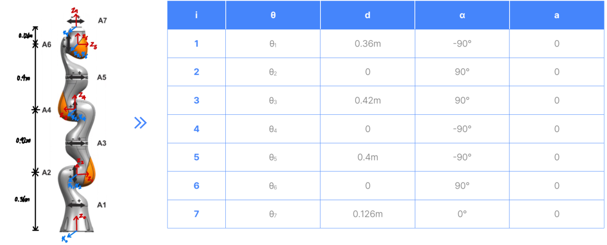
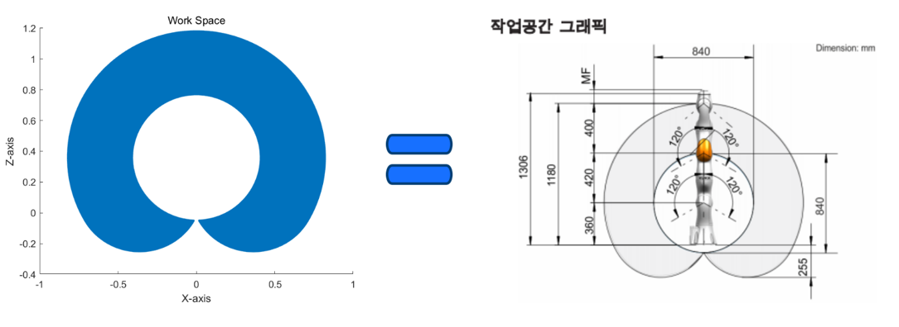
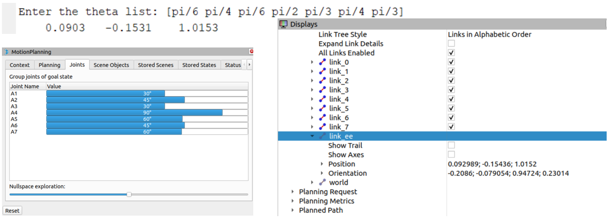
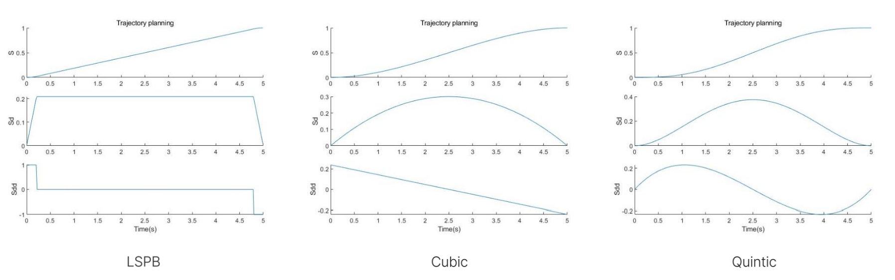

# 🖨️ MultiDOF-Sim: KUKA LBR iiwa 14 R820 Analysis
> **Robotics Term Project: Advanced Kinematics & Dual-Mission Trajectory Planning**

본 프로젝트는 7자유도 여유 자유도 로봇인 **KUKA LBR iiwa 14 R820**을 활용하여, 고정된 방향성(Orientation)을 유지하며 **선형(Linear) 및 원형(Circular) 궤적**을 추종하는 미션을 수행하고 그 과정을 분석한 연구입니다.

---

## 📐 1. 기구학 분석 및 모델링 (Kinematics Analysis)

### 1.1 Forward Kinematics & Modeling
* **이론적 분석:** 로봇 제원을 바탕으로 직접 **D-H Parameter**를 도출하고 좌표계를 설정하여 FK를 분석했습니다. (링크 길이 0.36m, 0.42m, 0.4m 등 반영)
* **시뮬레이션 모델:** 실제 구현 시에는 MATLAB `Robotics System Toolbox`의 **URDF 모델**을 호출하여 로봇의 동적 특성을 확보했습니다.

  
  
<i>직접 도출한 D-H 파라미터 및 좌표축 설정</i>

### 1.2 Forward Kinematics 검증
도출한 FK 모델의 정확성을 확인하기 위해 두 가지 검증 과정을 거쳤습니다.

1.  **작업 영역(Workspace) 비교:** MATLAB으로 플롯한 로봇의 가동 범위와 실제 제품 Data Sheet의 Workspace 도면을 비교하여 일치성을 확인했습니다.
2.  **ROS2 기반 데이터 검증:** KUKA 제공 ROS2 패키지에 특정 관절 각도를 입력하여 얻은 End-effector 좌표와 직접 작성한 MATLAB FK 코드의 결과값을 대조하여 수치적 정확도를 검증했습니다.

  
  
<i>MATLAB Workspace Plot vs Official Data Sheet 비교</i>

   
  
  
<i>ROS2 패키지 출력 데이터와 MATLAB 코드 결과값 수치 대조</i>

### 1.3 Inverse Kinematics (Technical Challenge)
* **Numerical IK 설계 및 한계:** 초기에는 수치적 역기구학 알고리즘을 직접 설계했으나, 7축 시스템의 높은 자유도로 인해 계산값이 목표치에 수렴하지 않는 문제가 발생했습니다.
* **해결 방법:** 시뮬레이션의 신뢰성을 위해 MATLAB 내장 `inverseKinematics` 함수를 도입하여 안정적인 수치적 해를 확보했습니다.

---

## 🎯 2. 미션 설정 (Mission Objectives)

두 가지 경로 생성 미션을 통해 로봇의 제어 성능을 검증했습니다.

* **미션 1: 선형 경로 (Linear Path)** - 두 지점 사이를 최단 거리로 이동.
* **미션 2: 원형 경로 (Circular Path)** - 3차원 평면상에서 정의된 원형 궤적을 정확히 추종.
* **공통 제약 (Fixed Orientation):** 모든 이동 과정에서 End-effector가 지면을 향한 고정된 방향을 유지해야 함.
* **제어 전략:** 모든 경로점에 동일한 Rotation Matrix를 부여하고, 이전 스텝의 결과값을 다음 스텝의 `initialguess`로 활용하여 연속성을 확보했습니다.

---

## 📈 3. 보간법별 동작 분석 (Trajectory Analysis)

  
  
<i>각 보간법 알고리즘별 s, sd, sdd 거동 분석 데이터</i>

실제 시뮬레이션 데이터를 통해 $s$(위치), $s_d$(속도), $s_{dd}$(가속도)의 프로파일을 분석한 결과입니다.

| 알고리즘 | 속도($s_d$) 및 가속도($s_{dd}$) 거동 특성 | 분석 결과 |
| :--- | :--- | :--- |
| **LSPB** | 속도가 상승 후 **일정 구간 상수로 유지**되다 하강함. 가속도는 상수값을 가지나 구간 이동 시 **불연속적(Step)**임. | 등속 구간이 필요한 작업에 유리하나 가속도 급변 시 기계적 충격 가능성 존재. |
| **Cubic** | 속도가 포물선 형태로 상승 후 하강함. 가속도는 **0.2에서 -0.2까지 직선 형태로 연속적으로 하강**함. | 가속도가 연속적이지만 변화율(Jerk)이 일정하여 고속 정밀 제어에는 한계가 있음. |
| **Quintic** | 속도 곡선에 변곡점이 존재하며, 가속도가 **$0 \rightarrow 0.2 \rightarrow -0.2 \rightarrow 0$으로 부드럽게 연결**됨. | 가속도 변화가 가장 매끄러워 로봇의 진동과 마모를 최소화할 수 있는 최적의 방식임. |

---

## 🎬 4. 최종 결과 분석 (Results)

* **미션 완수:** URDF 모델과 내장 IK 함수를 결합하여, 설정된 방향을 완벽히 유지하며 선형 및 원형 경로를 100% 추종하는 데 성공했습니다.
* **최종 결론:** 가속도($s_{dd}$)가 급격한 꺾임 없이 부드러운 S-커브를 형성하는 **Quintic(5차 다항식)** 보간법이 고도의 정밀도와 부드러운 모션이 요구되는 본 프로젝트 미션에 가장 적합함을 확인했습니다.

---